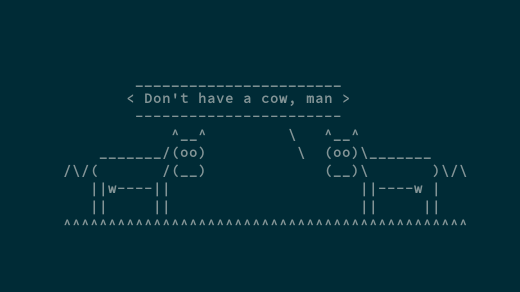

## Zadaci za vježbu: OS4 - Rad na Virtualnom stroju

### Zadatak 1: Ubuntu Server, JavaScript, Node.js i krave 🐮

Naučili ste da se JavaScript može pokretati u web pregledniku - jednostavno otvorimo web konzolu (DevTools) i možemo pisati i izvršavati JavaScript kod. Međutim, moguće ga je pokretati i izvan okruženja web preglednika, koristeći `Node.js` okruženje.

1. Pokrenite Ubuntu Server preko VirtualBox-a. Upute za instalaciju možete pronaći u skripti _OS4 - Rad na Virtualnom stroju: Uvod_. Ako ste već instalirali Ubuntu Server, preskočite ovaj korak.
2. Ažurirajte lokalnu listu paketa i verzija te instalirajte pakete `nodejs` i `npm` (_Node Package Manager_). Npm je alat koji se koristi za instalaciju i upravljanje paketima za Node.js okruženje.
3. Provjerite jesu li navedeni paketi uspješno instalirani; napišite na crtu kako to možete provjeriti na barem 2 načina na Ubuntu Serveru:

4. Pokrenite naredbu `node` u terminalu - to će otvoriti Node.js REPL okruženje u koje možete direktno pisati JavaScript kod. Osim toga, ako se uz istu naredbu navede i putanja do datoteke, Node.js će izvršiti JavaScript kod definiran u toj datoteci (_pokrenuti tu `js` skriptu_). Prebacite se u _home_ direktorij i napravite `node_project` direktorij.
5. Stvorite novu datoteku `hello.js` unutar tog direktorija te u nju pohranite vaše ime i prezime u varijablu i ispišite poruku u konzolu: `Pozdrav ja sam <ime i prezime> i uspješno sam pokrenuo JS u Node.js okruženju!` koristeći interpolaciju stringova.
6. Instalirajte Debian paket `cowsay` koji će ispisivati poruke u obliku krave 🐮. Proučite kako se paket paket koristi naredbom `man` (_manual_). Unutar istog direktorija, napišite bash skriptu koja očekuje jedan argument; ako korisnik nije proslijedio točno 1 argument vratite grešku i prekinite izvođenje skripte.
7. Ako je korisnik proslijedio točno 1 argument, njegovu vrijednost pohranite u varijablu `poruka` i pozovite `cowsay` naredbu s tom porukom unutar _bash_ skripte.
8. Pozovite bash skriptu, a kao argument proslijedite rezultat izvođenja (_output_) `node hello.js` datoteke (hint: _bash_ supstitucija naredbi).
9. Proučite još malo `cowsay` paket. Konkretno, zanimaju vas dostupne zastavice koje možete koristiti prilikom pozivanja `cowsay` naredbe. Primjerice, zanima vas kako iscrtati: _pohlepnu kravu, umornu kravu, paranoičnu kravu,...?_ Na crtu napišite sve dostupne <u>zastavice</u> koje ste pronašli.
10. Jednom kad ste pronašli odgovarajuće zastavice, nadogradite vašu _bash_ skriptu tako da korisnik može proslijediti i jednu od odgovarajućih zastavica kao drugi argument skripte, a ako proslijedi neispravnu zastavicu, ispišite grešku i prekinite izvođenje skripte; ako korisnik proslijedi ispravnu zastavicu, proslijedite ju `cowsay` naredbi. _Hint:_ _bash lista i par IF-ova ili petlja će vam biti od pomoći._

Primjer pokretanja:

```bash
./krava.sh "Pozdrav iz Node.js-a" -g
```


